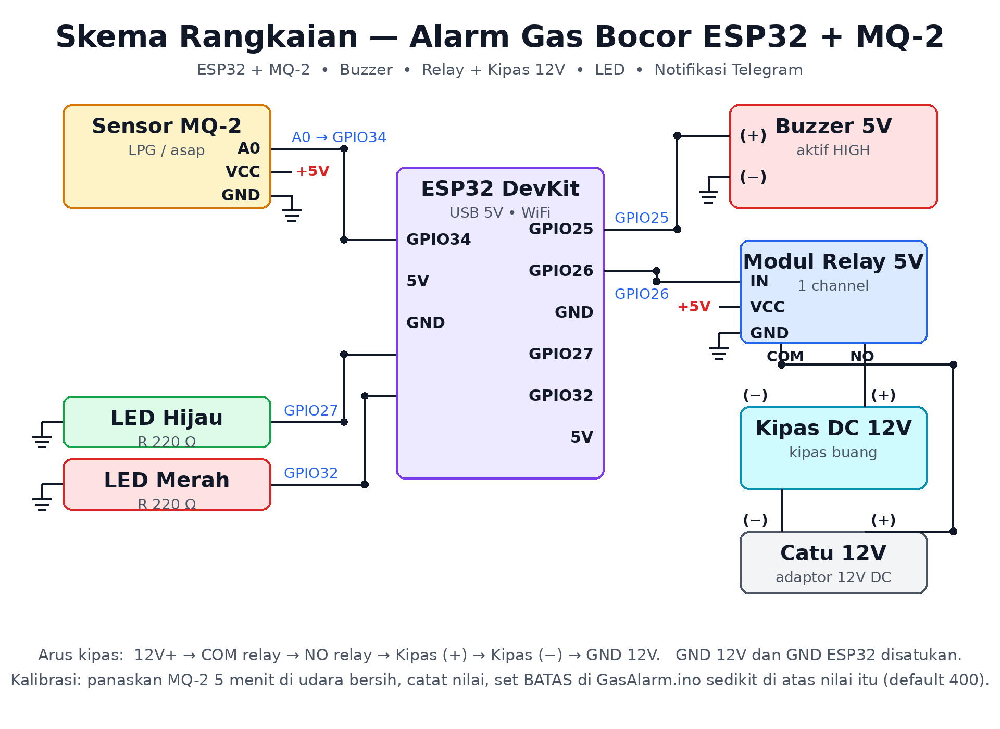

# Alarm Gas Bocor ESP32 + MQ-2

Alarm gas bocor + kipas buang otomatis berbasis ESP32 dan sensor MQ-2, dengan notifikasi Telegram. Kode dari YouTube Short **"Gas Bocor di Dapur? Alat Kecil Ini Bisa Selamatkan Rumahmu! | ESP32"**.

Gas bocor di dapur tidak berbau dan tidak terlihat, apalagi saat kamu tidur. Alat kecil ini berjaga 24 jam: sensor MQ-2 mencium gas, ESP32 membaca angkanya, dan begitu melewati batas bahaya, buzzer berbunyi putus-putus, kipas buang menyala, dan HP kamu langsung dapat notifikasi Telegram.

## Komponen

| Komponen | Keterangan |
|---|---|
| ESP32 DevKit | Board utama (WiFi built-in) |
| Sensor gas MQ-2 | Mendeteksi LPG / asap |
| Buzzer aktif 5V | Bunyi saat bahaya |
| Modul relay 5V, 1 channel | Menyalakan kipas 12V |
| Kipas DC 12V | Kipas buang |
| LED hijau + LED merah | Indikator aman / bahaya |
| Resistor 220 ohm (2x) | Untuk LED |

## Skema rangkaian



Arus kipas: 12V+ → COM relay → NO relay → Kipas (+) → Kipas (−) → GND 12V. GND 12V dan GND ESP32 disatukan.

## Wiring

| Komponen | Pin ESP32 |
|---|---|
| MQ-2 A0 | GPIO34 (analog) |
| MQ-2 VCC / GND | 5V / GND |
| Buzzer (+) | GPIO25, (-) GND |
| Relay IN | GPIO26 |
| LED hijau | GPIO27 (lewat 220 ohm ke GND) |
| LED merah | GPIO32 (lewat 220 ohm ke GND) |
| Kipas 12V | Lewat kontak relay (NO + COM), catu 12V terpisah |

## Library yang dibutuhkan (Arduino IDE)

Buka **Sketch > Include Library > Manage Libraries**, lalu install:

| Library | Penulis | Versi |
|---|---|---|
| **UniversalTelegramBot** | Brian Lough | 1.3.0 |
| **ArduinoJson** | Benoit Blanchon | **6.21.x (versi 6, BUKAN 7)** |

> ⚠️ **Penting:** UniversalTelegramBot 1.3.0 hanya cocok dengan ArduinoJson **versi 6**. Kalau terlanjur install ArduinoJson 7, hapus dan install 6.21.5 — kalau tidak, compile akan gagal.
>
> Library lain (WiFi, WiFiClientSecure) sudah bawaan board ESP32, tidak perlu install.

Board yang dipakai: **esp32 by Espressif Systems** (install lewat Boards Manager, pilih board "ESP32 Dev Module").

Tidak mau pakai Telegram? Ubah `#define USE_TELEGRAM 1` menjadi `0` di atas file `GasAlarm.ino` — maka kedua library di atas tidak dibutuhkan, alarm tetap jalan dan laporan hanya lewat Serial Monitor.

## Cara compile & upload

1. Buka `GasAlarm/GasAlarm.ino` di Arduino IDE.
2. Isi bagian konfigurasi di atas file:
   - `WIFI_SSID` dan `WIFI_PASSWORD` — WiFi rumahmu.
   - `BOT_TOKEN` — buat bot di Telegram: chat **@BotFather** → `/newbot` → salin tokennya.
   - `CHAT_ID` — chat **@userinfobot** di Telegram, catat angka "Id" kamu.
3. Pilih board **ESP32 Dev Module**, pilih port USB yang benar.
4. Klik **Upload**.

## Kalibrasi (wajib sebelum dipakai)

1. Panaskan MQ-2 minimal **5 menit** di udara bersih.
2. Buka **Serial Monitor** (115200 baud), catat nilai di udara bersih.
3. Set `BATAS` di file sedikit di atas nilai udara bersih itu (default 400).
4. Uji dengan gas korek api sebentar di dekat sensor — buzzer harus bunyi, kipas menyala, dan Telegram masuk.

## Cara kerja (logika inti)

```cpp
nilai = bacaSensor();              // rata-rata 10 kali baca
if (nilai > BATAS) {
  alarm();                         // buzzer putus-putus + LED merah
  kipasOn();                       // relay kipas ON
  kirimPesan();                    // Telegram, sekali per kejadian
}
```

Notifikasi Telegram dikirim **sekali** saat gas pertama kali melewati batas (bukan tiap detik), dan sekali lagi saat kadar gas kembali normal.

## Video

- Short 60 detik: ide → konsep → desain → implementasi (lihat deskripsi video untuk link).
- Sketsa ini adalah versi lengkap dari kode yang ditampilkan di video (di video, `kirimPesan()` masih Serial saja; di repo ini Telegram sudah jalan penuh).

## Lisensi

MIT — bebas dipakai, diubah, dan dibagikan, cantumkan sumber.
